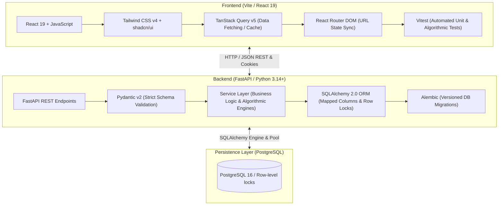
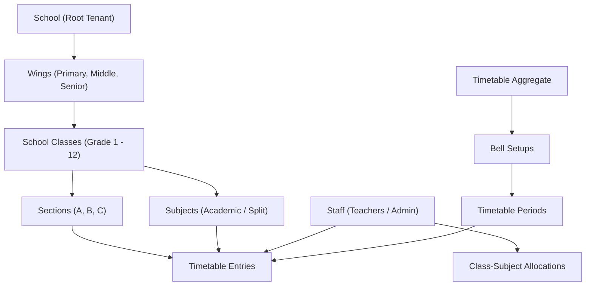
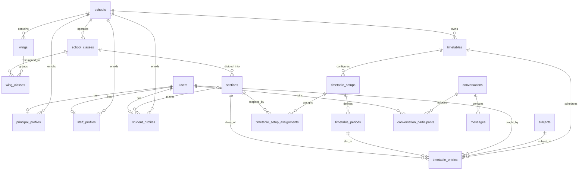

# School-LMS — Master System Architecture & Living Reference

> **Document Status**: Living Master Document  
> **Last Updated**: November 2026  
> **Purpose**: Serves as the definitive architectural blueprint, data dictionary, and operational runbook for the School-LMS platform. This document provides instant context anchoring for engineers and AI agents working on this codebase.

---

## 1. System Overview & Core Mission

**School-LMS** is an enterprise-grade School Management & Academic Logistics Platform designed for K–12 schools and educational institutions. It automates academic planning, timetable generation, staff allocation, student lifecycle tracking, and institutional administration.

### Multi-Tenancy & Data Isolation Model
- **Tenant Anchor**: School-owned records carry a `school_id`. The user table holds platform identities and the principal, staff and student profiles carry school membership.
- **Data Boundary**: School APIs derive the school from the authenticated profile. The administrator directory has an explicit platform-wide role check.
- **Role-Based Access Control (RBAC)**: Defined by `UserRole` (`app.models.enums`):
  - `ADMIN (0)`: Super Administrator with global platform visibility and school provisioning capabilities.
  - `PRINCIPAL (1)`: Institutional administrator managing school settings, wings, classes, staff, and timetable publishing.
  - `STAFF (2)`: Teaching and administrative personnel with role scopes (`is_academic`, `is_non_academic`).
  - `STUDENT (3)`: Enrolled learners represented by roster records.
  - `SALES_PERSON (4)`: Onboarding and platform adoption representatives.

---

## 2. Complete Technology Stack



### Backend Infrastructure
- **Runtime**: Python 3.14.2 in CI and the production image.
- **Web Framework**: FastAPI (Asynchronous & Synchronous endpoints with dependency injection).
- **ORM & Database**: SQLAlchemy 2.0 (`Mapped` typed attributes), Alembic for schema migrations.
- **Relational Engine**: PostgreSQL with strict Foreign Key constraints, indexed audit columns, and pessimistic row locking.
- **Validation**: Pydantic v2 (Strict boundary validation at the HTTP layer with custom field validators).
- **Security & Session**: Browser sign-in uses a revocable, HttpOnly cookie. API clients can sign in for an expiring HS256 bearer token. Passwords use bcrypt. PostgreSQL holds shared sign-in rate counters.

### Frontend Infrastructure
- **Framework**: React 19 (SPA with React Router DOM).
- **Bundler & Tooling**: Vite 8.2+ with Rolldown compiler and PostCSS.
- **Styling & UI Kit**: Tailwind CSS v4, shadcn/ui, Radix UI headless primitives, Lucide React icons.
- **Server State**: TanStack Query (React Query v5) with query key factories and cache invalidation.
- **Local & URL State**: Bidirectional synchronization between URL query parameters (`?timetable_id=...&perspective=...&wing=...`) and React state.
- **Test Harness**: Vitest with `@testing-library/react`.

---

## 3. Core Functional Modules



### A. School Structure & Hierarchy
- **`School` (`schools`)**: Holds school branding, affiliation, contact information, and academic calendar settings.
- **`Wing` (`wings`)**: Logical institutional division (e.g., *Pre-Primary, Primary, Middle, Secondary*).
- **`SchoolClass` (`school_classes`)**: Standard grades (e.g., *Grade 6, Grade 7*). Joined to wings via `wing_classes`.
- **`Section` (`sections`)**: Individual classroom cohorts (e.g., *6-A, 6-B*). Linked to `class_teacher_id` (`User`).
- **`House` (`houses`)**: Student houses for extracurricular activities and color competitions.

### B. Staff & Faculty Management
- **`User` (`users`)**: Core identity record with email, login mobile, role, and hashed credentials.
- **`StaffProfile` (`staff_profiles`)**: Stores roll number, department, designation, academic/non-academic flags, and shift preferences.
- **`StaffWing` (`staff_wings`)**: Multi-wing mapping associating teachers with applicable school sections.
- **`StaffOnboardingToken`**: Secure, time-limited token enabling principal-driven email invitations.

### C. Student Lifecycle
- **`StudentProfile` (`student_profiles`)**: Stores roll number, date of birth, house, and parent names. The school-scoped backfill links matched records to `sections.id`. Class and section labels remain available for compatibility and unmatched historical records. The list excludes contact, birth-date and family fields. Individual detail, export and deletion actions use separate permissions and audit events.

### D. Subjects & Curriculum Allocation
- **`Subject` (`subjects`)**: Supports standalone subjects, elective categories, and split/parent-child lab pairings (`is_split`, `parent_id`).
- **`ClassSubject` (`class_subjects`)**: Triple-binding entity allocating a specific teacher to teach a subject in a specific class-section with weekly period quotas.

### E. Internal Communications
- **Chat** uses `conversations`, `conversation_participants` and `messages` for direct, group and broadcast messages between staff and principals. REST and WebSockets share a client message ID for safe retries. Deployments with multiple backend workers share Redis fan-out and presence leases. PostgreSQL is the message source of truth.

---

## 4. Timetable Management Engine (Deep Dive)

The Timetable module is the most algorithmically complex system in the LMS. It handles bell timing schedules, room/teacher conflict checks, multi-day variations, drag-and-drop allocations, and official board publishing.

### 1. Conceptual Model: Setup vs. Schedule vs. Period
- **Timetable (`timetables`)**: Root aggregate container for an academic year. Supports `is_active` (currently followed by school) and `status` (`DRAFT`, `PUBLISHED`).
- **Setup (`timetable_setups`)**: A group of classes that ring bells together (e.g., *Primary Setup 08:00–13:30*, *Senior Setup 08:30–14:30*).
- **Schedule**: Day-level timing configuration within a Setup. By default, days share one `regular` schedule. Days can be split off into independent schedules (e.g., `saturday` half-day, `friday` assembly) and merged back as needed.
- **Period (`timetable_periods`)**: The individual slot. Types:
  - `CLASS`: Teaching periods (auto-numbered sequentially: `P1`, `P2`, `P3`).
  - `RECESS`: Break/Lunch interval.
  - `ASSEMBLY`: Morning gathering or pledge.
  - `ACTIVITY`: Sports, clubs, or zero-hour activities.

---

## 5. Timetable invariants

- `timetable_periods` stores the canonical times and period types. The schedule JSON stores schedule IDs and applicable days. Reads can still use legacy JSON metadata while existing setups transition.
- The frontend compares times in minutes from midnight. The backend and frontend validate overlap and continuity before saving a setup.
- Draft mutations and publication take a PostgreSQL lock on the timetable before locking its setup or changing its periods or entries. Setup updates check their version. Publish takes the reviewed draft version and validates and snapshots it under the same lock.
- Batch saves require one assignment per active section. Unknown and foreign school targets are rejected. SQL also enforces the school, timetable and setup relationship for new or changed assignments.
- An existing lesson follows its equivalent period when a schedule is split, merged or reassigned. A change that leaves a lesson without a valid teaching slot returns a conflict. The editor preserves the local changes on failure.

## 6. Database Entity-Relationship Diagram



---

## 7. Project Directory Structure & Key Files Map

```text
School-LMS/
├── SYSTEM_ARCHITECTURE.md              # THIS LIVING MASTER DOCUMENT
├── readme.md                           # Quickstart guide & local setup notes
├── Backend/
│   ├── app/
│   │   ├── main.py                     # FastAPI application factory & CORS configuration
│   │   ├── api/
│   │   │   ├── deps.py                 # Dependency injection (get_db, current_user, RBAC)
│   │   │   └── v1/
│   │   │       ├── router.py           # Main v1 router assembly
│   │   │       └── endpoints/
│   │   │           ├── timetable.py    # Timetable, Setups & Grid REST endpoints
│   │   │           ├── auth.py         # Sign-in, sign-out and session lookup
│   │   │           ├── staff.py        # Staff profile management
│   │   │           └── school_config.py# Wings, Classes, Sections, Houses
│   │   ├── core/
│   │   │   ├── config.py               # Pydantic environment settings
│   │   │   ├── database.py             # SQLAlchemy engine & sessionmaker
│   │   │   └── exceptions.py           # Standard HTTP exception classes (409, 422, 404)
│   │   ├── models/
│   │   │   ├── timetable.py            # Timetable, TimetableSetup, TimetablePeriod, TimetableEntry
│   │   │   ├── user.py                 # Core User entity & audit fields
│   │   │   ├── staff.py                # StaffProfile & StaffWing
│   │   │   └── school_class.py         # SchoolClass (sections and wings have their own models)
│   │   ├── schemas/
│   │   │   └── timetable.py            # Pydantic request/response schemas (BatchSetupItem, etc.)
│   │   └── services/
│   │       ├── timetable_service.py    # Core business logic for Timetable & Bell Setups
│   │       ├── bell_timing_validator.py# Sweep-Line interval validator ($O(N log N + k)$)
│   │       └── timetable_export_service.py # Excel workbook generator
│   └── tests/
│       ├── test_bell_timing.py         # Bell setups, version checks and validators
│       └── test_section_teacher_independence.py # Teacher isolation verification tests
│
└── Frontend/
    ├── src/
    │   ├── api/
    │   │   └── timetableService.js     # Axios API layer for timetable endpoints
    │   ├── hooks/
    │   │   └── useTimetable.js         # React Query hooks (useClassWiseTimetable, useSetups, etc.)
    │   ├── pages/
    │   │   └── timetable/
    │   │       ├── TimeTable.jsx       # Main Timetable view orchestrator
    │   │       ├── bellTiming/         # Bell Timing Setup modal & timeline engine
    │   │       │   ├── BellTimeline.jsx# Interactive drag-and-drop timeline
    │   │       │   ├── scheduleReducer.js # Structural-sharing state manager (undo/redo)
    │   │       │   ├── timeUtils.js    # Integer minute calculations ($0..1439$)
    │   │       │   ├── validators.js   # Frontend Sweep-Line overlap validator
    │   │       │   └── __tests__/      # Tests for time math, reducer and UI
    │   │       └── components/
    │   │           ├── BellScheduleSetupModal.jsx # Multi-setup bell configuration modal
    │   │           ├── ClassWiseGridView.jsx      # Interactive weekly class schedule grid
    │   │           └── TeacherWiseGridView.jsx    # Teacher availability and schedule grid
    │   └── components/ui/              # shadcn/ui shared components (Button, Dialog, Popover)
    └── package.json                    # Dependencies & build scripts
```

---

## 8. Developer verification

See [the README](readme.md) for local setup. Set `LMS_TEST_DATABASE_URL` to a separate PostgreSQL database whose name ends in `_test` before running the backend suite.

- From `Backend`, run `python -m pytest --cov=app tests` and `python -m alembic upgrade head --sql`. Offline SQL generation needs a PostgreSQL URL in the configuration.
- From `Frontend`, run `npm ci`, `npm run lint -- --max-warnings=0`, `npm run typecheck`, `npm run test:coverage`, `node --test --test-isolation=none test_chat_date.js` and `npm run build`. The strict JavaScript type check starts with the modules listed in `tsconfig.check.json`.
- Run `npm run typecheck:all` to type-check all production frontend source. CI requires both the full check and the scoped strict check.
- The [verification workflow](.github/workflows/verify.yml) runs the headless suites, SQL generation, dependency checks and the frontend build.
- See [release operations and student records](docs/operations.md) for deployment and privacy procedures, and the [remediation log](REMEDIATION_LOG.md) for verification results.
